# GolemCraft

**Automate. Defend. Explore.**
A NeoForge mod that turns copper, iron and a carved pumpkin into a small army of loyal, specialised golems.

[](https://www.minecraft.net/)
[](https://neoforged.net/)
[](https://adoptium.net/)
[](https://github.com/MicheleChierchia/GolemCraft/actions/workflows/build.yml)
[](#license)

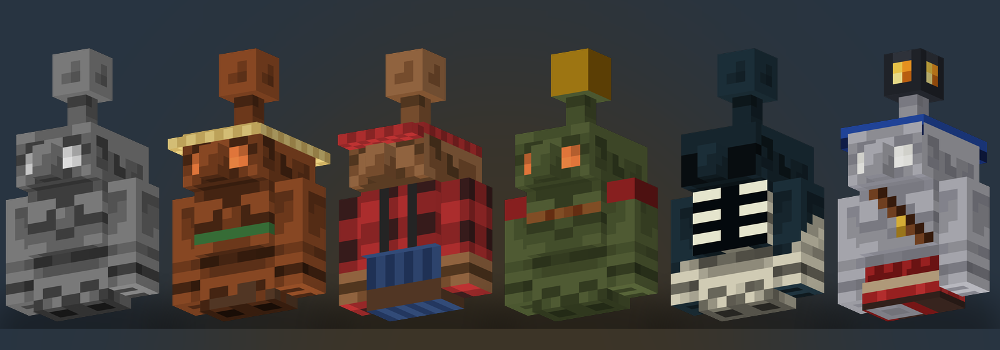

---

## Meet the golems

Every golem starts life as a **Base Golem** — a blank copper chassis that oxidises, charges in storms and follows its owner. Hand it the right tool and it becomes a specialist.

| | | | | |
|:---:|:---:|:---:|:---:|:---:|
| 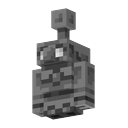 | 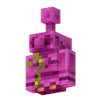 | 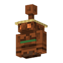 | 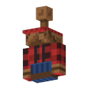 | 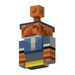 |
| **Base** | **Flower** | **Farmer** | **Lumberjack** | **Fisherman** |
| 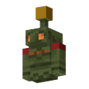 | 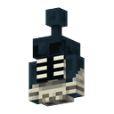 | 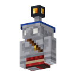 | 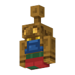 | 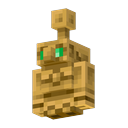 |
| **Soldier** | **Depth** | **Explorer** | **Leveler** | **Totem** |

## Roles at a glance

| Golem | Evolve with | What it does |
| --- | --- | --- |
| **Base** | — | The starting chassis. 27-slot internal inventory (`Shift + Right-Click`), follows its owner, never hurts allies. |
| **Flower** | Any flower | Collects nearby flowers and deposits them into the nearest chest. |
| **Farmer** | Hoe | Tills soil, harvests mature crops, replants seeds and stores the yield. |
| **Lumberjack** | Axe | Fells trees, gathers logs, apples and saplings, then replants. |
| **Fisherman** | Fishing Rod | Fishes nearby water and stores fish and treasure. |
| **Soldier** | Sword, Bow, Crossbow or Trident | Fights hostile mobs; switch between companion and fixed guard post. |
| **Depth** | Echo Shard | Blind, hunts by sound and fires sonic booms at whatever it hears. |
| **Explorer** | Recovery Compass | Permanent light source. Collects your dropped items when you die and waits for you on site. |
| **Leveler** | Shovel | Excavates and fills terrain inside two **Area Markers**, then deposits the materials. |
| **Totem** | Totem of Undying | Follows you everywhere and triggers a totem resurrection if you die within 16 blocks. |

Use a **Brush** on any specialist to reset it back into a Base Golem. Held tools drop on the ground; consumables used for the evolution are not refunded.

## Oxidation & charge

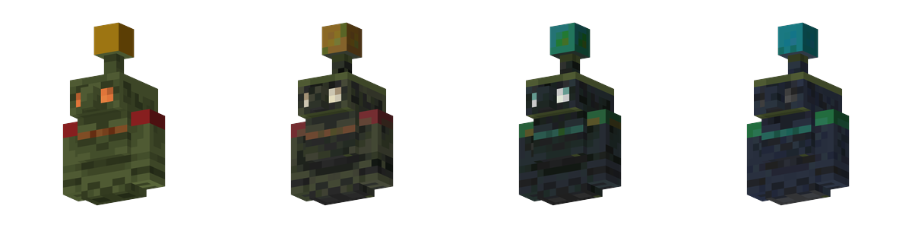

Copper never stays shiny. Every golem slowly moves through four oxidation stages:

1. **Unaffected** — fast and shiny.
2. **Exposed** — a first green patina.
3. **Weathered** — heavily oxidised, slower.
4. **Oxidized** — a solid statue: immobile and immune to damage until scraped.

- **Wax** with a honeycomb to lock the current stage.
- **Scrape** with an axe to remove patina or wax and wake a statue up again.
- **Charge** by letting a golem get struck by lightning, or by giving it the *Charge* effect from a Golem Beacon. Charged golems work faster and hit harder.

## Golem Beacon

A copper beacon that buffs every golem in range. Build a pyramid of copper blocks underneath it — one to four tiers — then place the beacon on top with open sky above.

| Tier | Pyramid | Powers |
| --- | --- | --- |
| 1 | 3×3 | Speed / Haste |
| 2 | 5×5 | Resistance / Jump Boost |
| 3 | 7×7 | Regeneration / Charge / Oxidation Immunity |
| 4 | 9×9 | A second power, or level II buffs |

Open the beacon menu, insert a copper ingot and pick the power you want.

## Tools & automation

| Item | Recipe | Purpose |
| --- | --- | --- |
| **Golem Manual** | Book + Copper Ingot (shapeless) | In-game illustrated guide with every role, mechanic and recipe. |
| **Golem Compass** | Compass surrounded by 8 Copper Ingots | Points at the Explorer Golem it is linked to, anywhere in the world. |
| **Area Marker** | Copper Ingot + Redstone Torch | Place two markers to define a rectangle and a target Y level for the Leveler Golem. |
| **Base Golem** | Iron Block + Carved Pumpkin (or place the item) | Creates a new golem. |

Working golems deposit their loot into nearby chests, so keep storage close to the job site.

## Getting started

1. Craft or place a **Base Golem** (Iron Block with a Carved Pumpkin on top).
2. Right-click it while holding a tool to assign a role.
3. Give it a chest nearby and watch it work.
4. Wax it with honeycomb before it oxidises into a statue.
5. Craft the **Golem Manual** for the full in-game documentation.

## Installation

- **Minecraft** 26.2
- **NeoForge** 26.2.0.67 or newer
- **Java** 25

Grab the latest JAR from the [Releases](https://github.com/MicheleChierchia/GolemCraft/releases) page and drop it into your `mods/` folder.

## Building from source

```bash
./gradlew build        # compile and package the mod JAR
./gradlew runClient    # launch the development client
./gradlew runServer    # launch the development server
./gradlew runData      # run data generation
```

The Java 25 toolchain is provisioned automatically by Gradle through the Foojay resolver; any JDK 21+ can start the build.

### Project layout

```
src/main/java/com/golemcraft/golemcraftmod/
├── entity/        golems, projectiles, fishing hook
├── entity/ai/     custom AI goals
├── block/         Golem Beacon, Area Marker
├── item/          Base Golem, Golem Manual, Golem Compass
├── network/       payloads and registration
├── registry/      DeferredRegisters (blocks, items, entities, effects)
├── client/        models, renderers, screens
└── events/        game and client event handlers
```

### Preview renders

The images in this README are generated from the mod's own entity textures:

```bash
.venv/bin/python3 generate_golem_renders.py
```

The script rebuilds the golem models from the Minecraft box-UV layout and writes isometric renders to `docs/images/`.

## License

All Rights Reserved. © Michele Chierchia
